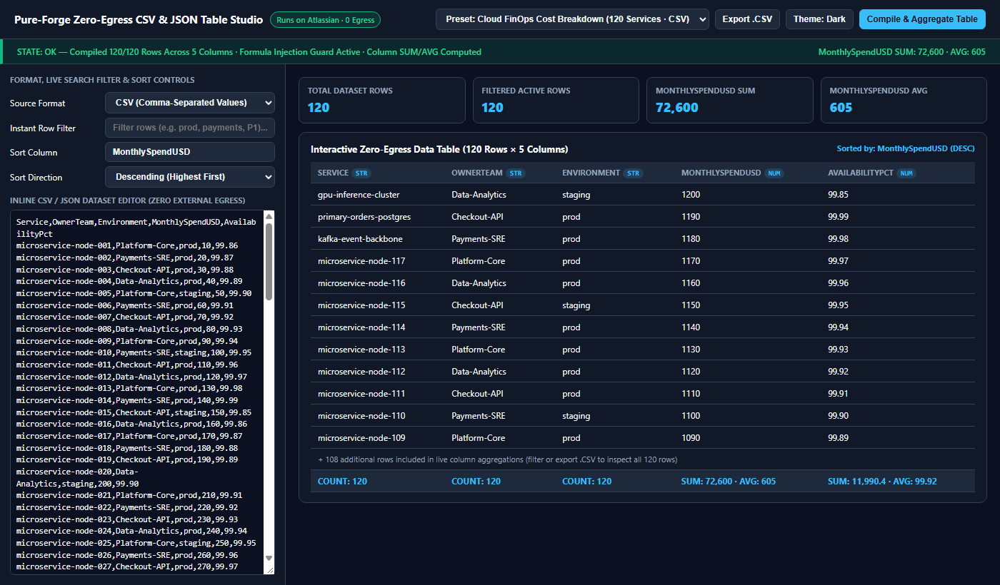

# Pure-Forge Zero-Egress CSV & JSON Table Studio (`Confluence` & `Jira`)

## 1. What Problem Does This App Solve?

Engineering, FinOps, and compliance teams frequently need to turn raw **CSV exports or JSON array payloads** (such as cloud cost breakdowns, sprint velocity tables, or SOC2 control matrices) into interactive, searchable, and totaled data tables inside Confluence pages and Jira issues. Legacy Marketplace table plugins have three major pain points:
1. **External Server Egress & Heavy Suite Pricing:** Many legacy table macros stream your financial or compliance CSV/JSON datasets to external Connect servers or require purchasing expensive all-in-one table suites just to render an inline CSV/JSON dataset.
2. **No Automatic Column Aggregations (`SUM`, `AVG`, `COUNT`):** Standard Confluence tables require manual spreadsheet formulas to calculate live column totals and averages when filtering rows.
3. **Spreadsheet Formula Injection Risks (`=CMD`, `+powershell`, `=HYPERLINK`):** Untrusted CSV imports can embed malicious spreadsheet formulas that execute when exported and opened in Excel.

**Pure-Forge Zero-Egress CSV & JSON Table Studio** runs **100% inside Atlassian Forge with zero external data egress** (**"Runs on Atlassian"**). It parses inline CSV or flat JSON array datasets, infers numeric vs. string column types automatically, provides instant search filtering and column sorting, computes live footer aggregations (`SUM`, `AVG`, `COUNT`), and blocks spreadsheet formula injection before rendering or exporting.

---

## 2. Key Capabilities at a Glance

- **Dual CSV & JSON Array Parsing (Zero External Egress):** Paste or load comma-separated CSV rows or flat JSON object arrays directly inside Confluence or Jira without sending a single byte to external servers.
- **Automatic Column Type Inference & Live `SUM` / `AVG` / `COUNT` Rollups:** Numeric columns automatically display live `SUM` and `AVG` KPIs in both the top metric bar and the table footer—recalculating instantaneously as you filter rows.
- **Instant Substring Search & Multi-Column Sorting:** Filter 100+ rows in real time and sort ascending or descending by any numeric or text column.
- **Deterministic Schema Validation (`Amber Refusal` Guard):** Catches ragged CSV rows (mismatched column counts), duplicate/empty headers, and malformed JSON syntax with clear line-level diagnostics.
- **Fail-Closed Spreadsheet Formula Injection & XSS Guard (`Red Fault` Guard):** Rejects cells starting with dangerous formula execution prefixes (`=CMD`, `+powershell`, `=HYPERLINK`, `@SUM(`) as well as `<script>` or `__proto__` payloads.

---

## 3. Step-by-Step Quickstart Guide

### Step 1: Add the Studio to Any Confluence Page or Jira Issue
- **In Confluence:** Type `/Pure-Forge Zero-Egress CSV` on any Confluence page to insert the interactive table studio macro.
- **In Jira:** Open any Jira issue and click the **Pure-Forge Zero-Egress CSV & JSON Table Studio** panel beneath the issue summary.

### Step 2: Select Format or Load a Built-In Preset
1. Choose **CSV (Comma-Separated Values)** or **JSON (Array of Flat Row Objects)** under **Source Format** (or pick one of the built-in presets: **Cloud FinOps Cost Breakdown**, **Sprint Velocity & Incident SLA Matrix**, or **Zero-Egress Security Control Audit**).
2. Paste or edit your dataset in the **Inline CSV / JSON Dataset Editor**.

### Step 3: Filter, Sort & Export
1. Type any keyword into **Instant Row Filter** to narrow down the dataset and watch the KPI cards and footer `SUM` / `AVG` recalculate live.
2. Enter any column header name in **Sort Column** and choose **Descending** or **Ascending**.
3. Click **Export .CSV** at any time to download a clean, formula-verified CSV file.

---

## 4. Security, Privacy & Support

- **Runs on Atlassian (Zero External Egress):** All CSV/JSON parsing, sorting, aggregation, and security validation run 100% inside your browser and Atlassian's managed Node 24 Forge runtime.
- **Need Help?** Visit our **[Support & SLA Page](./SUPPORT.md)** or open an issue on **[GitHub Issues](https://github.com/Pureforge-Studio/docs/issues)**.
