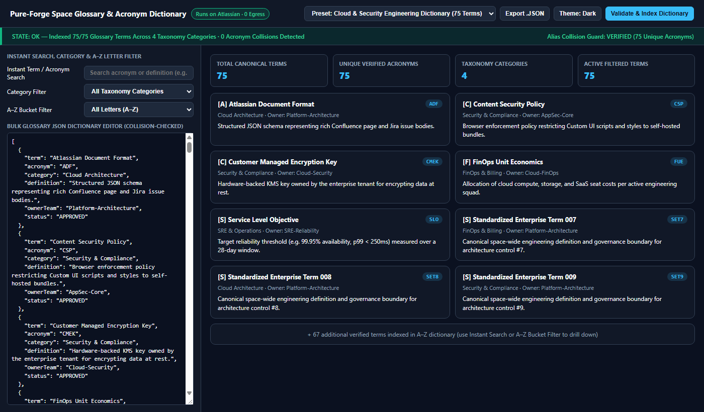

# Pure-Forge Space Glossary & Acronym Dictionary (`Confluence` & `Jira`)

## 1. What Problem Does This App Solve?

As engineering, security, and product organizations scale, new hires and cross-functional teams struggle with hundreds of internal acronyms (`ADF`, `CSP`, `CMEK`, `SLO`, `FUE`) scattered across disconnected Confluence pages. Legacy Marketplace glossary plugins create three recurring headaches:
1. **Conflicting Acronym Collisions:** Different teams define the same acronym (`SLA`) with conflicting meanings in the same Confluence space without any automated collision detection.
2. **External Database Dependencies:** Legacy Connect glossary plugins store your proprietary terminology and product definitions in external vendor databases outside Atlassian Cloud.
3. **Clunky Navigation & No Bulk JSON Import/Export:** Standard Confluence tables lack instant A–Z letter bucket filtering, category taxonomy filtering, and 1-click JSON export.

**Pure-Forge Space Glossary & Acronym Dictionary** runs **100% inside Atlassian Forge with zero external data egress** (**"Runs on Atlassian"**). It indexes space terminology into an interactive A–Z dictionary with taxonomy category filters, enforces a deterministic **Acronym & Canonical Term Collision Guard**, and blocks untrusted script or prototype pollution payloads.

---

## 2. Key Capabilities at a Glance

- **Interactive A–Z Bucket & Taxonomy Category Filtering:** Drill down across 75+ canonical engineering, security, SRE, and FinOps terms by letter (`A–Z`), category, or live substring search.
- **Deterministic Acronym & Canonical Term Collision Guard (`Amber Refusal`):** Automatically detects and blocks duplicate term names or conflicting definitions claiming the same acronym (e.g., two different entries claiming `SLA`).
- **Bulk JSON Dictionary Editor & 1-Click `.JSON` Export:** Maintain your glossary as version-controlled JSON directly inside the studio and export at any time.
- **Fail-Closed XSS & Prototype Pollution Guard (`Red Fault`):** Rejects untrusted `<script>` tags, inline event handlers, and `__proto__` payloads before rendering or saving to Forge storage.

---

## 3. Step-by-Step Quickstart Guide

1. **Insert the Glossary Studio:** Type `/Pure-Forge Space Glossary` on any Confluence page (or open the **Pure-Forge Space Glossary & Acronym Dictionary** panel on any Jira issue).
2. **Search or Filter by Category & Letter:** Use **Instant Term / Acronym Search**, **Category Filter**, or **A–Z Bucket Filter** to locate definitions immediately.
3. **Add or Import Terms:** Edit the JSON array in the **Bulk Glossary JSON Dictionary Editor** and click **Validate & Index Dictionary** to verify zero acronym collisions.

---

## 4. Security, Privacy & Support

- **Runs on Atlassian (Zero External Egress):** All glossary terms, acronym indexes, and taxonomy categories stay 100% inside your Atlassian Cloud environment.
- **Need Help?** Visit our **[Support & SLA Page](./SUPPORT.md)** or open an issue on **[GitHub Issues](https://github.com/Pureforge-Studio/docs/issues)**.
