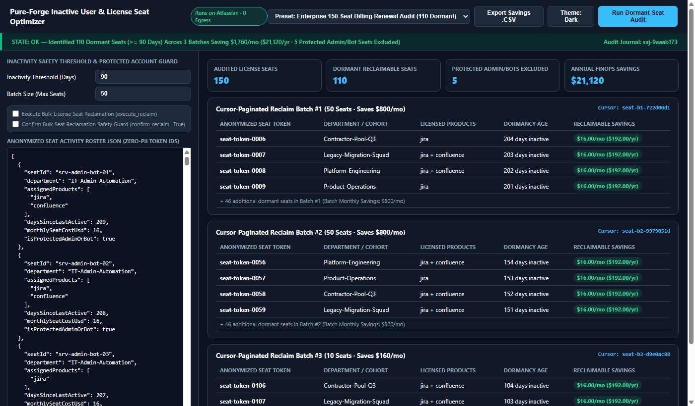

# Pure-Forge Inactive User & License Seat Optimizer (`Jira` & `Confluence`)

## 1. What Problem Does This App Solve?

Before monthly or annual Atlassian Cloud billing renewals, IT and FinOps administrators need to identify dormant Jira and Confluence user seats (such as offboarded contractors or inactive accounts) so they aren't billed for unused licenses. Existing Marketplace user-deactivation utilities suffer from three critical pitfalls:
1. **Accidental Deactivation of Service Accounts & Admins:** Bulk user deactivators frequently sweep up CI/CD release bots or break-glass admin accounts that don't log in interactively, breaking production pipelines.
2. **No Minimum Inactivity Safety Floor:** Admins can accidentally enter a low threshold (e.g., 7 days) and lock out active employees returning from vacation.
3. **External PII Egress Risks:** Sending employee seat rosters to third-party external servers triggers privacy and compliance blocks.

**Pure-Forge Inactive User & License Seat Optimizer** runs **100% inside Atlassian Forge with zero external data egress** (**"Runs on Atlassian"**) and operates on **anonymized zero-PII seat tokens**. It identifies dormant seats exceeding your inactivity threshold (default `90` days), automatically excludes protected admin and bot accounts (`isProtectedAdminOrBot: true`), enforces a **14-day minimum inactivity safety floor**, calculates exact **monthly and annual USD FinOps savings**, and groups reclaimable seats into cursor-paginated batches with an audit journal (`saj-...`).

---

## 2. Key Capabilities at a Glance

- **Automatic Protected Admin & Service Bot Exclusion:** Seats flagged as `isProtectedAdminOrBot: true` are automatically excluded from reclamation batches and counted separately in your KPI dashboard.
- **Monthly & Annual FinOps License Savings Calculator:** Instantly totals reclaimable monthly (`$/mo`) and annualized (`$/yr`) savings per seat and per cursor-paginated batch.
- **14-Day Inactivity Safety Floor & Confirmation Guard (`Amber Refusal`):** Refuses inactivity thresholds below `14` days so active users are never disrupted, and requires explicit `confirm_reclaim=True` confirmation before executing bulk seat reclamation.
- **Zero-PII Tokenized Auditing (`100% Runs on Atlassian`):** Audits anonymized seat tokens (`seat-token-0006`) without storing or exporting user names or email addresses.

---

## 3. Step-by-Step Quickstart Guide

1. **Open the Seat Optimizer in Jira or Confluence:** Open any Jira governance ticket or Confluence FinOps review page and launch **Pure-Forge Inactive User & License Seat Optimizer**.
2. **Set Your Inactivity Threshold & Batch Size:** Enter your target **Inactivity Threshold (Days)** (default `90`, minimum `14`) and **Batch Size** (default `50`).
3. **Review Reclaimable Batches & Annual Savings:** Inspect the cursor-paginated reclamation batches (`seat-b1-...`), verify protected admin/bot exclusions, and click **Export Savings .CSV** to attach the FinOps audit summary to your renewal review.

---

## 4. Security, Privacy & Support

- **Runs on Atlassian (Zero External Egress & Zero PII):** All seat dormancy calculations and audit journals execute inside Atlassian's managed Node 24 Forge runtime.
- **Need Help?** Visit our **[Support & SLA Page](./SUPPORT.md)** or open an issue on **[GitHub Issues](https://github.com/Pureforge-Studio/docs/issues)**.
