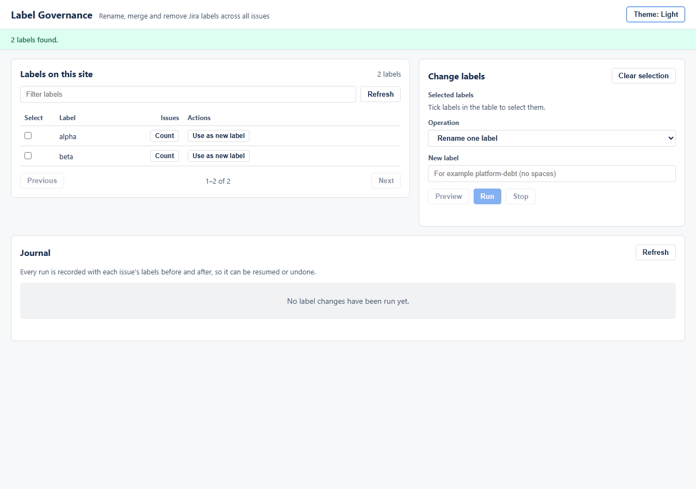

# Label Governance — User Guide

**Works in:** Jira (admin page)
**Hosting:** runs entirely on Atlassian Forge, with no outbound network access. Changes are made through Jira's own API with your permissions.

Label Governance lets Jira admins rename, merge and remove labels across every issue that carries them, with a preview first and an undo afterwards.

---

## Open the app

Go to **Jira settings → Apps → Label Governance**. Only people who can open Jira's app admin pages see it.

## Quick start

1. **Labels on this site** lists your labels. Use **Previous** and **Next** to page through, or type to filter. Pick a label to see roughly how many issues use it.
2. Select one or more labels, then click **Change labels**.
3. Choose an **Operation**:
   - **Rename one label**: for example `ui` → `user-interface`.
   - **Merge selected labels into one**: for example `front-end`, `FrontEnd` → `frontend`. Each issue ends up with the target label exactly once.
   - **Remove selected labels from all issues**: requires an extra confirmation.
4. Click **Preview** to see how many issues will change.
5. Click **Run**. Progress shows as the run works through the issues; **Stop** halts it cleanly.

## Journal and undo

The **Journal** keeps the 25 most recent runs, with their labels, counts, status and any failed issues. For each changed issue it records the labels before and after, so you can **undo** a run. Undo restores the labels the run changed. Issues that someone has edited by hand since are left as they are.

## Safety

- Delete needs an explicit confirmation.
- Labels are checked before a run: no spaces, 1 to 255 characters, and no script markup.
- Issues are changed 50 at a time, and each step stays within Forge's time limit. Large runs continue across steps and never time out halfway.
- If Jira rate-limits the app, the run waits and retries.
- Only the labels field of each issue is changed.

## Limits

| Limit | Value |
| --- | --- |
| Source labels per operation | 20 |
| Issues changed per step | 50 |
| Runs kept in the journal | 25 |

## Permissions

| Scope | Why |
| --- | --- |
| `storage:app` | Keep the run journal, so runs can resume and be undone. |
| `read:jira-work` | List labels and find the issues that carry them. |
| `write:jira-work` | Update the labels on those issues. |

The app acts as the admin who starts the run, so it can only change issues that admin can edit.

## FAQ

**Does this work for Confluence labels?** No. It manages Jira issue labels only.

**Are user names stored in the journal?** No. The journal holds labels, counts, dates and issue IDs and keys only.

**What happens if the licence lapses?** New runs are refused until the licence or trial is active again.
