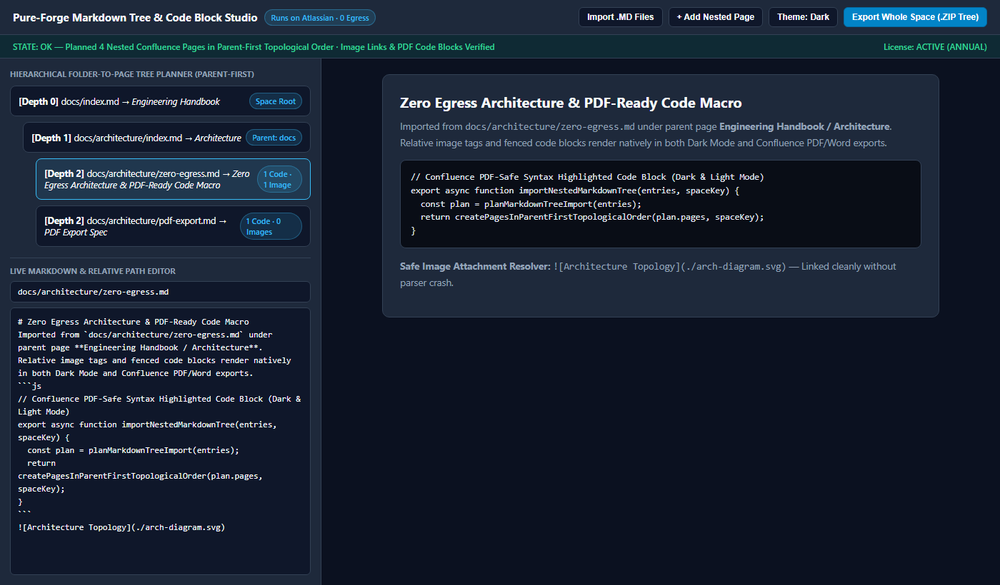

# Markdown Tree Studio — User Guide

**Works in:** Confluence (page macro, and a space page for import and export)
**Runs on Atlassian:** yes. Files are read in your browser and pages are created through Confluence's own API.

Markdown Tree Studio does three things:

- **Import** a folder of Markdown files as Confluence pages, keeping the folder structure as the page tree.
- **Export** a Confluence page and everything under it as a `.zip` of Markdown files.
- **Show live Markdown** on any page with the Markdown macro.



---

## Import a folder of Markdown files

1. In the space, open **Markdown Import & Export** from the space sidebar.
2. Click **Choose folder…** (or **Choose .md files…**).
3. Pick the parent page with **Change…**. The default is the space homepage.
4. Choose what happens if a page title already exists in the space:
   - **Skip existing pages**: keep the existing page and put any child pages under it.
   - **Add a number suffix**: create "Title (2)", "Title (3)" and so on.
   - Otherwise the import pauses and asks you.
5. Click **Preview page tree** and check the result.
6. Click **Create pages in Confluence**.

**How files become pages:**

```text
docs/                         Confluence
├── index.md          ──►     Docs (parent page)
├── setup.md          ──►     ├── Setup
└── guides/                   └── Guides
    ├── README.md     ──►         (content of Guides)
    └── deploy.md     ──►         └── Deploy
```

- Each sub-folder becomes a parent page. Its `index.md` or `README.md`, if there is one, becomes that page's content.
- A page's title is the file's first heading, or the file name if there is no heading.
- Existing pages are never overwritten.

**Large imports** run in chunks. If you close the tab, reopen the space page and click **Continue import** to finish where it stopped, with no duplicates.

## Export pages as Markdown

1. On the same space page, under **Export pages as Markdown (.zip)**, click **Change…** and choose the top page.
2. Click **Export .zip**.

The `.zip` mirrors the page tree. A page with children becomes a folder with an `index.md`, for example `Root/index.md` and `Root/Section/Leaf.md`.

## Live Markdown macro

Edit a page, type `/`, and choose **Pure-Forge Bi-Directional Markdown Tree Importer, Exporter & Live Macro**. Click **Edit Markdown**, write or paste Markdown, then **Save**. Headings, lists, task lists, tables, links, code blocks (readable in dark mode) and images are supported. Each macro keeps its own content.

## What converts, and how

| Markdown | In Confluence |
| --- | --- |
| Headings, lists, task lists, tables, quotes, code blocks | Native Confluence formatting |
| Links | `http`, `https` and `mailto` links only; others become plain text |
| Images | `https` images display; `http` images become links; relative paths such as `./img.png` become plain text, because the image files are not uploaded |
| Raw HTML | Shown as text, never run |

## Limits

| Limit | Value |
| --- | --- |
| Files per import | 1,000 |
| Total size per import | 2 MB |
| Pages created per import | 300 |
| Pages per export | 500 |
| Macro content | 100,000 characters |

## Permissions

| Scope | Why |
| --- | --- |
| `storage:app` | Save macro content and the progress of imports and exports. |
| `read:space:confluence`, `read:page:confluence` | List a space's pages for the page picker, and read the pages you export. |
| `write:page:confluence` | Create the pages you import. |

You can only import into spaces where you can create pages, because the app acts with your Confluence permissions.

## FAQ

**Are my files uploaded anywhere?** No. They are read in your browser and sent only to Confluence, as new pages.

**What happens if the licence lapses?** Macro content still displays. Importing, exporting and saving need an active licence or trial.
