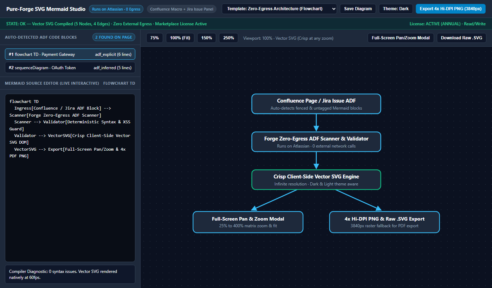
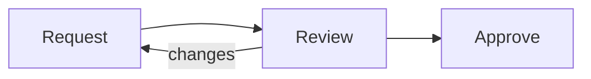

# Mermaid Diagram Studio — User Guide

**Works in:** Confluence (macro) and Jira (issue panel)
**Hosting:** runs entirely on Atlassian Forge, with no outbound network access. Diagrams render in your browser and are saved in Forge storage on your own site.

Mermaid Diagram Studio turns Mermaid text into sharp, zoomable SVG diagrams inside Confluence pages and Jira issues. It uses the official Mermaid library, bundled with the app, so nothing is fetched from the internet.

---

## Quick start

1. **Confluence:** edit a page, type `/`, and choose **Mermaid Diagram Studio**.
   **Jira:** open an issue and open the **Mermaid Diagram Studio** panel.
2. Pick a template, type Mermaid in the editor, or click a diagram the app found on the page (see below).
3. Click **Save**. In Confluence, publish the page as usual.

Each macro and each Jira issue keeps its own diagram, so several macros on one page don't overwrite each other.

## Use Mermaid code blocks already on the page

When the studio opens, it reads the page or issue it sits on and lists its Mermaid code blocks in page order, including blocks inside panels and expands. A code block counts if its language is `mermaid`, or if it starts with a Mermaid header such as `flowchart`, `sequenceDiagram` or `gantt`. Click a block to load it into the editor.

## View, zoom and export

- **Zoom** from 25% to 400%, drag to pan, and use **Full screen** for large diagrams.
- **Export PNG** at 4x resolution for slides and documents. Very large diagrams are capped at 3,840 px wide, 4,096 px tall and about 16.7 megapixels, so the file always opens.
- **Export SVG** for a vector file that stays sharp at any size.
- **Theme:** follows light or dark mode, or toggle it yourself.

## Supported diagram types

Flowchart (`flowchart`, `graph`), sequence, state, entity relationship, class, Gantt, pie, user journey, quadrant, requirement, Git graph, C4 (context, container, component, dynamic, deployment), mind map, timeline, Sankey, XY chart, block, packet, kanban, architecture, radar and treemap.

## Messages you may see

| Banner | Meaning | What to do |
| --- | --- | --- |
| Amber, with a line number | The Mermaid text has a syntax error. Your last good diagram stays on screen. | Fix the line shown. |
| Amber, "limited to 50,000 characters" | The diagram source is too long. | Split it into smaller diagrams. |
| Amber, licence message | The licence or trial is not active. Saved diagrams still display, read-only. | Ask your site admin to renew. |
| Red | Something unexpected failed. | Reload. If it keeps happening, contact [support](./SUPPORT.md) with the message text. |

## Security

Diagrams render with Mermaid's strict security level, so they cannot run scripts or click handlers. Source containing `<script>`, `javascript:` or inline event handlers is refused.

## Permissions

| Scope | Why |
| --- | --- |
| `storage:app` | Save each diagram on your site. |
| `read:page:confluence`, `read:jira-work` | Read the page or issue the app sits on to find Mermaid code blocks. The app never edits them. |

## FAQ

**Does diagram text leave our site?** No. Rendering happens in your browser, and diagrams are stored in Forge storage on your site.

**What happens if the licence lapses?** Saved diagrams still display. Saving changes needs an active licence or trial.
