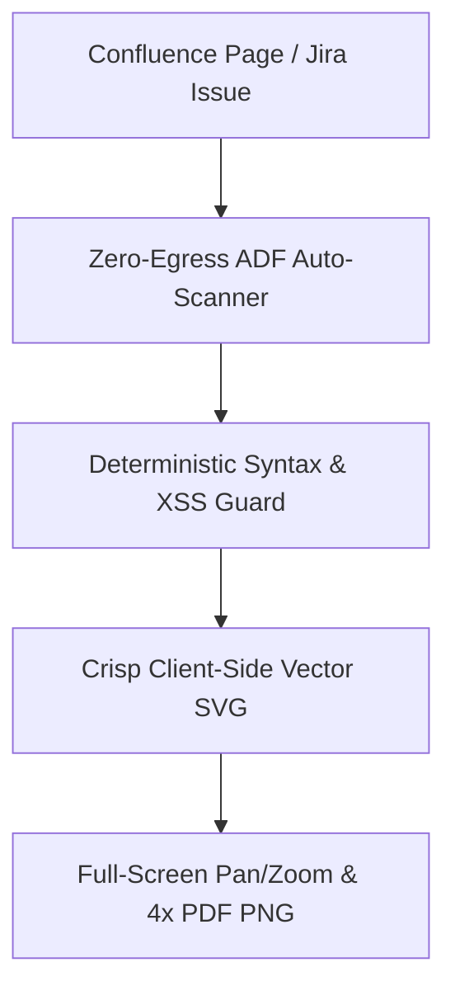

# User Guide: Pure-Forge SVG Mermaid Studio (Confluence & Jira)

**Marketplace App Key:** `studio.pureforge.svg-mermaid-studio`  
**Security Architecture:** 100% Zero-Egress Atlassian Forge (**"Runs on Atlassian"**)

---

## 1. What Problem Does This App Solve?

Software engineers, architects, and product managers love **Mermaid** because it lets you draw flowcharts, sequence diagrams, and state machines using simple text instead of dragging boxes in a drawing tool.

However, teams using Confluence and Jira routinely run into four frustrating problems with older Mermaid plugins:
1. **Blurry, Unreadable Diagrams:** Many plugins save diagrams as small, low-resolution PNG thumbnails that turn blurry when zoomed in or viewed on a 4K display.
2. **No Full-Screen Pan & Zoom:** Large system architecture diagrams get squeezed into a narrow Confluence column with no way to pop them open full-screen and zoom around.
3. **Forced External Accounts:** Some plugins require every teammate to create and pay for an external account on a third-party website—and if someone leaves the company, their diagrams disappear.
4. **Broken Auto-Detection:** When you already have ```` ```mermaid ```` code blocks on a Confluence page, older viewers often fail to detect them or crash on YAML frontmatter (`---`) and comments (`%%`).

**Pure-Forge SVG Mermaid Studio solves all four problems natively inside your Atlassian Cloud site.**


---

## 2. How to Use It (3-Step Quickstart)

### Step 1: Insert the Macro on Any Confluence Page
1. Edit any Confluence Cloud page.
2. Type **`/mermaid`** and select **Pure-Forge SVG Mermaid & Technical Diagram Studio** from the slash-command menu.

### Step 2: Type Mermaid Code — or Click an Auto-Detected Block from Your Page
When the Studio opens, you have two ways to load a diagram:
- **Option A (Auto-Detect Existing Code Blocks):** Look at the **"Auto-Detected ADF Code Blocks"** panel in the top-left corner. The app automatically scans your page for any existing ```` ```mermaid ```` code blocks (as well as untagged code blocks starting with `flowchart`, `sequenceDiagram`, `stateDiagram-v2`, `erDiagram`, `classDiagram`, `gantt`, or `pie`). Click any detected block to render it immediately.
- **Option B (Live Editor):** Type or paste your Mermaid diagram into the **Mermaid Source Editor** on the left.

Example snippet you can paste right away:


### Step 3: Zoom, Toggle Dark/Light Theme, or Export for PDF
Use the top toolbar above the diagram canvas to:
- **Zoom (`75%`, `100% Fit`, `150%`, `250%`, up to `400%`):** Because the diagram is a real `<svg>` vector element in your browser DOM, text and lines stay razor-sharp at every zoom level.
- **Full-Screen Pan/Zoom Modal:** Click **Full-Screen Pan/Zoom Modal** to inspect large multi-service diagrams without Confluence page-width restrictions.
- **Export 4x Hi-DPI PNG (`3840px`) or Raw `.SVG`:** Click **Export 4x Hi-DPI PNG (3840px)** or **Download Raw .SVG** whenever you need a high-resolution image for a Confluence PDF/Word export or slide deck.

---

## 3. Built-In Safety & Syntax Guardrails

- **Live Syntax Guard (Amber Banner):** If you make a typo while editing (for example, typing `NodeA -->` before typing the target node name), the Studio highlights the exact line number in a calm **Amber Diagnostic Banner** while keeping your last valid SVG diagram visible on screen—so your diagram never flashes blank while you type.
- **Fail-Closed XSS Protection (Red Fault Guard):** Any untrusted `<script>`, `javascript:`, or inline event handler inside a diagram source is automatically blocked before touching the browser DOM.

---

## 4. Frequently Asked Questions (FAQ)

**Q: Does any diagram text leave our Confluence Cloud site?**  
**A:** No. All parsing and vector SVG rendering happen locally inside your browser and Atlassian Forge storage (`storage:app`). There are zero external network calls.

**Q: What happens if our trial expires before purchasing?**  
**A:** Your diagrams are never deleted or hidden. If a license becomes inactive, the app enters **Read-Only Preview Mode** so your team can continue viewing all existing diagrams until your admin renews the subscription.
