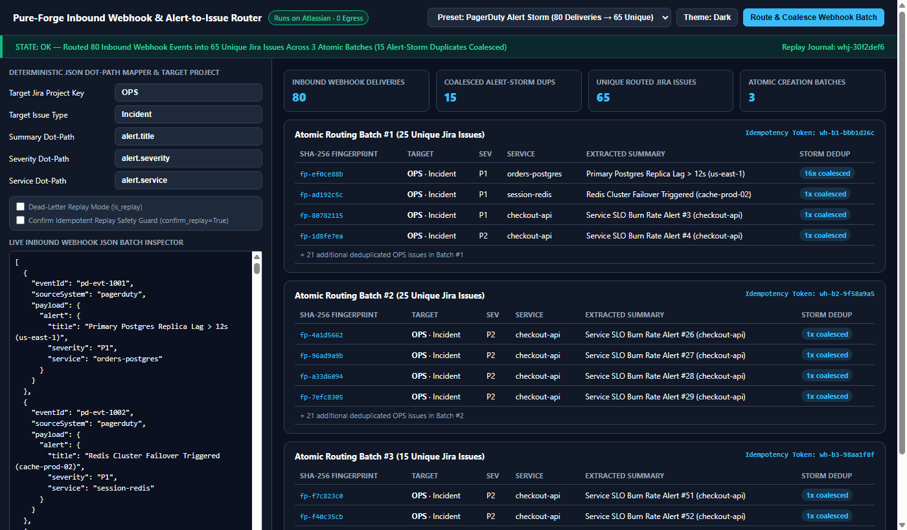
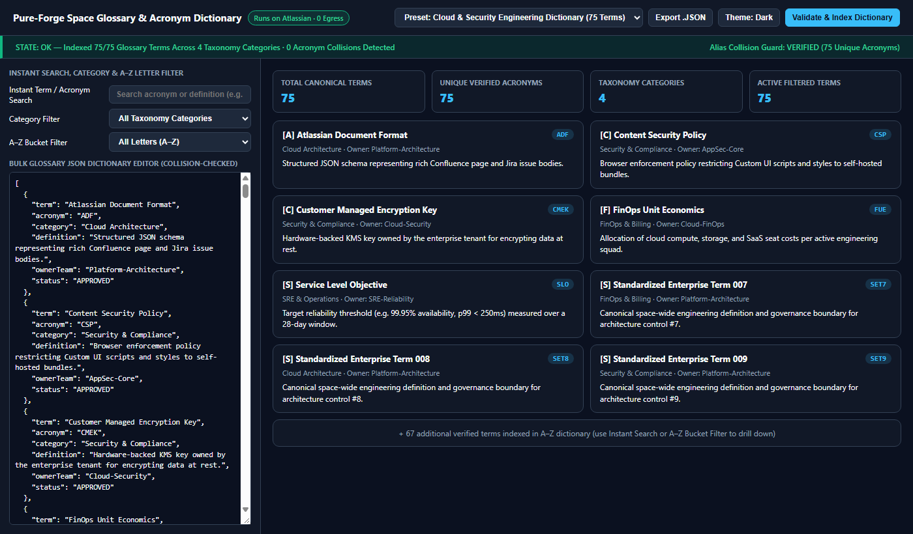
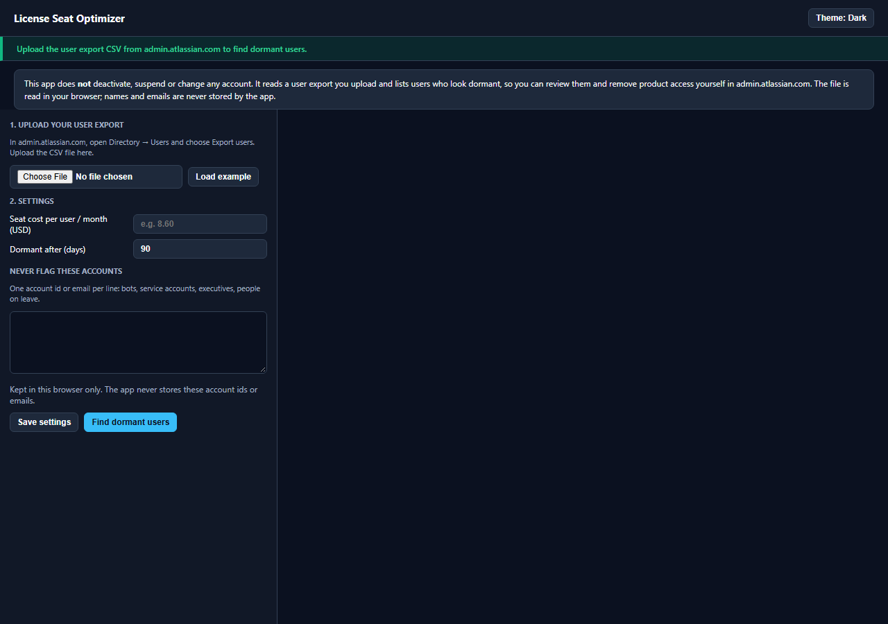

# PureForge-Studio Documentation

PureForge-Studio makes Confluence and Jira Cloud apps that run entirely on Atlassian Forge. Your data stays in your Atlassian site: the apps have no outbound network access and we run no servers of our own ("Runs on Atlassian").

## Apps

| App | Works in | What it does | Guide |
| --- | --- | --- | --- |
| Mermaid Studio | Confluence, Jira | Sharp, zoomable Mermaid diagrams with full screen, 4x PNG and SVG export, and detection of Mermaid code blocks already on the page. | [Guide](./MERMAID_STUDIO_GUIDE.md) |
| Markdown Tree Studio | Confluence | Imports a folder of Markdown files as a page tree, exports a page tree as a `.zip` of Markdown, and shows live Markdown in a macro. | [Guide](./MARKDOWN_TREE_GUIDE.md) |
| Label Governance | Jira | Renames, merges and removes Jira labels across every issue, with preview, progress, stop and undo. | [Guide](./LABEL_GOVERNANCE_GUIDE.md) |
| Webhook Router | Jira | A secret webhook address that turns JSON events into Jira issues, with field mapping, priorities and duplicate suppression. | [Guide](./WEBHOOK_ROUTER_GUIDE.md) |
| JSON/CSV Table Studio | Confluence, Jira | Sortable, filterable tables from CSV or JSON, with Sum and Avg for numeric columns and protection against spreadsheet formulas in exports. | [Guide](./CSV_JSON_TABLE_GUIDE.md) |
| Glossary & Taxonomy Studio | Confluence, Jira | One shared A–Z glossary per space or project that refuses duplicate terms and clashing acronyms. | [Guide](./GLOSSARY_STUDIO_GUIDE.md) |
| License Seat Optimizer | Jira, Confluence (admin) | Finds dormant users in your admin.atlassian.com user export and estimates the savings. It never deactivates anyone. | [Guide](./INACTIVE_SEAT_AUDITOR_GUIDE.md) |

## Screenshots

| | |
| --- | --- |
|  |  |
|  |  |
|  |  |
|  | |

## How we handle your data

- **No outbound network access.** No app declares external egress, so Forge blocks calls to outside servers.
- **No accounts elsewhere.** Nothing to sign up for outside Atlassian.
- **No personal data stored.** No app stores Atlassian account IDs, names or email addresses.
- **No outside scripts.** Every library ships inside the app.

Each guide lists the app's permissions and why it needs them. The [Privacy Policy](./PRIVACY.md) lists exactly what each app stores.

## Policies and help

- [Support](./SUPPORT.md)
- [Privacy Policy](./PRIVACY.md)
- [Terms of Use](./TERMS.md)
- [Security Policy](./SECURITY.md)
