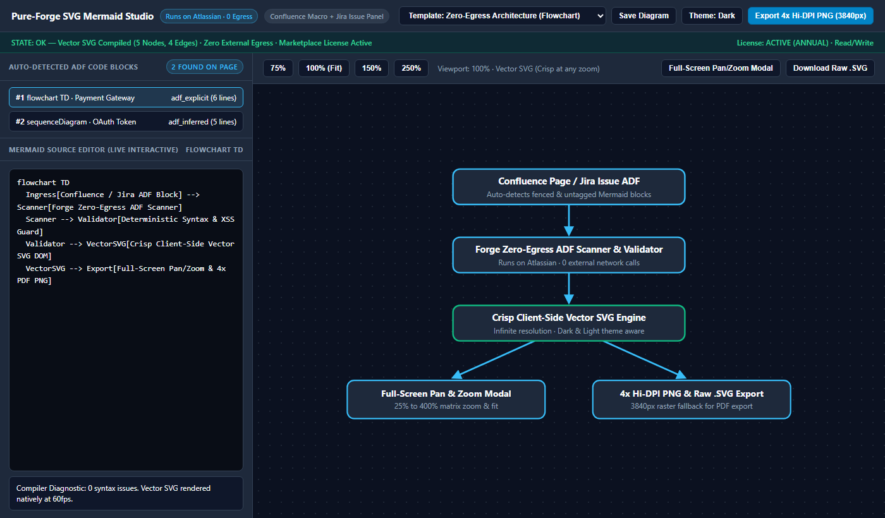
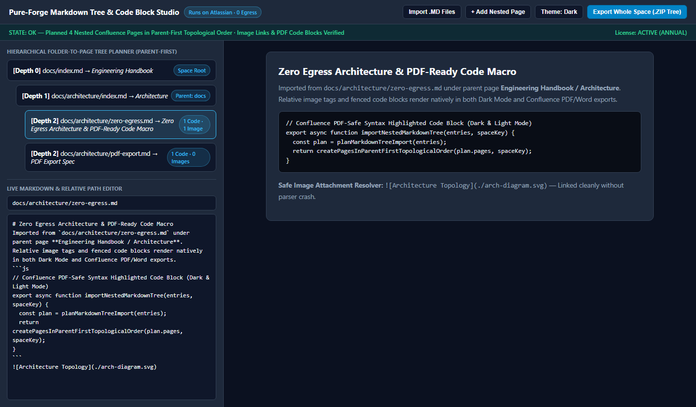
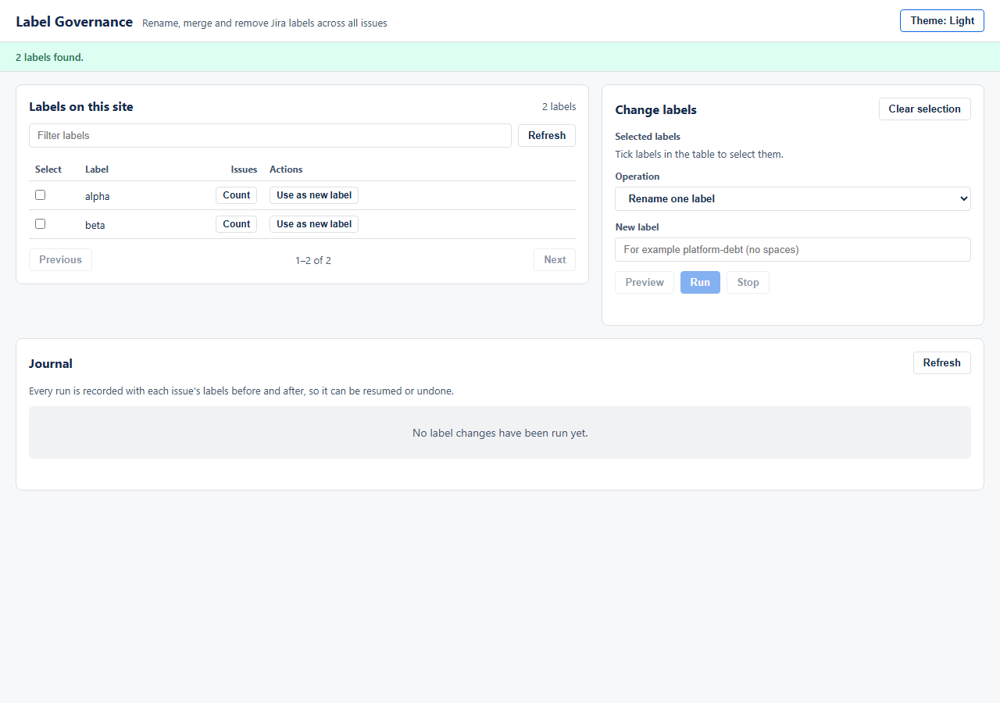
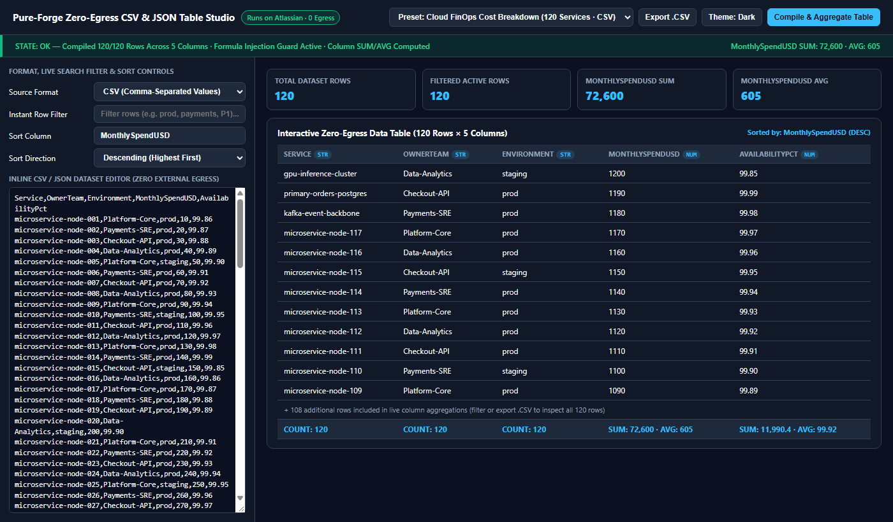

# PureForge-Studio — Customer Documentation & Quickstart Portal

Welcome to the official customer documentation hub for **PureForge-Studio**. We build fast, reliable Confluence and Jira Cloud apps that run **100% inside Atlassian Forge with zero external data egress** (**"Runs on Atlassian"**).

---

## Our Applications (Click Any App for the Full Step-by-Step User Guide)

| Application | Host Product | What Problem It Solves in Plain English | Full User Guide |
| :--- | :---: | :--- | :--- |
| **1. Pure-Forge SVG Mermaid Studio** | Confluence & Jira | Turns text-based Mermaid flowcharts and architecture diagrams into **razor-sharp, zoomable vector SVG diagrams** (never blurry PNG images), with full-screen pan/zoom, automatic Dark Mode, 4x Hi-DPI PDF export, and automatic detection of existing page code blocks. | **[Read the Mermaid Studio Guide](./MERMAID_STUDIO_GUIDE.md)** |
| **2. Pure-Forge Markdown Tree Studio** | Confluence | Imports nested folders of `.md` (Markdown) files into Confluence **while preserving your exact parent-child page hierarchy** (instead of dumping files into a flat list), exports spaces back to a folder tree of `.md` files, and renders dark-mode PDF-ready code blocks. | **[Read the Markdown Tree Studio Guide](./MARKDOWN_TREE_GUIDE.md)** |
| **3. Pure-Forge Bulk Label Governance** | Jira & Confluence | Lets Jira admins **merge duplicate labels, rename typos, color-tag, or delete obsolete labels across hundreds of Jira tickets in one click**—using safe 50-issue batches and an undo journal so big projects never time out or white-screen. | **[Read the Bulk Label Governance Guide](./LABEL_GOVERNANCE_GUIDE.md)** |
| **4. Pure-Forge Inbound Webhook & Alert Router** | Jira & Confluence | Routes inbound JSON alerts (**PagerDuty, Datadog, Sentry, GitHub Actions**) into Jira issues and Confluence incident pages with **SHA-256 alert-storm deduplication** (so 80 duplicate alerts don't create 80 tickets), deterministic dot-path field extraction, and idempotent replay protection. | **[Read the Inbound Webhook Router Guide](./WEBHOOK_ROUTER_GUIDE.md)** |
| **5. Pure-Forge Zero-Egress CSV & JSON Table Studio** | Confluence & Jira | Turns inline **CSV or JSON array datasets** into interactive, sortable, searchable data tables with **automatic numeric column totals (`SUM`, `AVG`, `COUNT`)** and **spreadsheet formula-injection protection (`=CMD`, `+powershell`)**—with zero external server egress. | **[Read the CSV & JSON Table Studio Guide](./CSV_JSON_TABLE_GUIDE.md)** |
| **6. Pure-Forge Space Glossary & Acronym Dictionary** | Confluence & Jira | Indexes space-wide **engineering, security, and product terminology into an interactive A–Z dictionary** with taxonomy category filtering and an automatic **Acronym & Canonical Term Collision Guard** so teams never publish conflicting definitions. | **[Read the Space Glossary Guide](./GLOSSARY_STUDIO_GUIDE.md)** |
| **7. Pure-Forge Inactive User & License Seat Optimizer** | Jira & Confluence | Audits **dormant Jira and Confluence license seats** (`>= 90` days inactive), calculates **monthly & annual FinOps savings**, automatically excludes **protected admin/bot service accounts**, and enforces a **14-day safety floor** with zero PII egress. | **[Read the License Seat Optimizer Guide](./INACTIVE_SEAT_AUDITOR_GUIDE.md)** |

---

## Visual Overview of Our Applications

### 1. Pure-Forge SVG Mermaid Studio (`Confluence` & `Jira`)

### 2. Pure-Forge Markdown Tree Studio (`Confluence`)

### 3. Pure-Forge Bulk Label Governance (`Jira` & `Confluence`)

### 4. Pure-Forge Inbound Webhook & Alert-to-Issue Router (`Jira` & `Confluence`)

### 5. Pure-Forge Zero-Egress CSV & JSON Table Studio (`Confluence` & `Jira`)

### 6. Pure-Forge Space Glossary & Acronym Dictionary (`Confluence` & `Jira`)

### 7. Pure-Forge Inactive User & License Seat Optimizer (`Jira` & `Confluence`)

---

## Why IT & Security Admins Trust PureForge-Studio ("Runs on Atlassian")

Many legacy Marketplace plugins send your Confluence pages, diagrams, or Jira tickets to third-party external servers to render or process them—creating security review bottlenecks and requiring external vendor accounts.

Every **PureForge-Studio** application is architected under our **Zero-Egress Security Standard**:
- **Zero External Network Calls:** `permissions.external` is completely omitted from our Atlassian Forge manifests. Your diagrams, Markdown documents, and Jira labels never leave your Atlassian Cloud instance.
- **No External Accounts Required:** You never need to sign up for an external account (such as `mermaid.live`) to create, view, or edit content.
- **Zero Personal Data (PII) Stored:** We do not collect, copy, or store user names, email addresses, or Atlassian `AccountID`s.
- **Zero External CDN Dependencies:** All UI assets are self-contained inside the Atlassian Forge Custom UI bundle, so our apps work even in strict enterprise browser environments.

---

## Legal, Privacy & Support Links

- **[Customer Support & SLA](./SUPPORT.md)** — Need help or have a feature request? Open a ticket on our **[GitHub Issue Tracker](https://github.com/Pureforge-Studio/docs/issues)**.
- **[Privacy Policy](./PRIVACY.md)** — Our zero-egress, zero-PII data handling guarantee.
- **[Terms of Service & EULA](./TERMS.md)** — Commercial subscription terms via Atlassian Marketplace.
