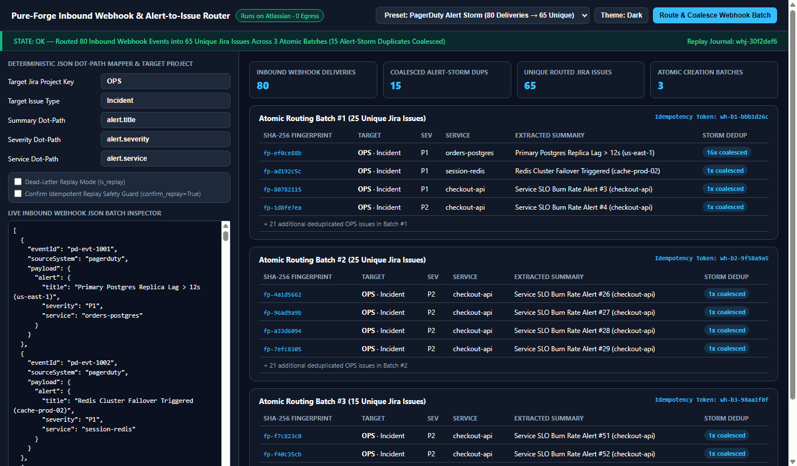

# Webhook Router — User Guide

**Works in:** Jira (admin page, plus an inbound webhook address)
**Hosting:** runs entirely on Atlassian Forge, with no outbound network access. The webhook address is a Forge web trigger, and issues are created through Jira's own API.

Webhook Router gives you a secret webhook address. Any tool that can send JSON over HTTPS — monitoring, CI, alerting or your own scripts — can post to it, and each event becomes a Jira issue. Repeats of the same alert are skipped instead of filling your backlog.



---

## Set it up

1. Go to **Jira settings → Apps → Webhook Router**.
2. Under **Settings**:
   - **Jira project key** (for example `OPS`), then **Find issue types** and pick the **Issue type to create**.
   - **Summary field**: the dot path to the issue summary in your JSON, for example `alert.title`. Required.
   - **Severity field**, **Service field**: optional dot paths, added to the issue description.
   - **Dedupe key field**: optional, for example `alert.id`. Events with the same value inside the **Dedupe window** become one issue.
   - **Severity → Jira priority**: one mapping per line, for example `critical = Highest`.
   - **Labels to add**: comma separated.
3. Click **Save settings**.
4. Under **Try a payload**, click **Load example** and **Preview mapping** to check the result, then **Send test event** to create a real test issue.
5. Copy the **Webhook address** into your sending tool.

## Send events

Use either form:

```bash
# Token in the address (simplest)
curl -X POST "https://<your-webhook-address>?token=<token>" \
  -H 'Content-Type: application/json' \
  -d '{"alert":{"title":"Disk full on db-1","severity":"critical","id":"inc-1"}}'

# Token in a header
curl -X POST "https://<your-webhook-address>" \
  -H 'Authorization: Bearer <token>' -H 'Content-Type: application/json' \
  -d '{"alert":{"title":"Disk full on db-1","severity":"critical","id":"inc-1"}}'
```

Send one JSON object, or an array of up to 50 objects to create several issues at once.

## What the sender gets back

| HTTP status | Meaning |
| --- | --- |
| 202 | Accepted: issues were created. |
| 200 | Duplicate: already seen inside the dedupe window, so no new issue. |
| 400 | Invalid: not POST, not JSON, too large, or missing the summary field. |
| 401 | Missing or wrong token. |
| 402 | No active licence or trial. |
| 503 | The router has not been configured yet. |
| 500 | Something unexpected failed; the sender should retry. |

**Recent deliveries** on the admin page shows the last 50 results with the time, outcome, issue key and a short reason.

## Duplicates

With a **Dedupe key field**, events that share the same value in the same project count as one alert for the dedupe window (default 60 minutes, at most 7 days). Without one, events with the same project, service and summary count as the same alert. Test events never suppress real ones.

## Security

- Every request needs the secret token. **Regenerate token** immediately invalidates the old address.
- Bodies over 256 KB, or with more than 50 events, are refused.
- Payload values are treated as plain text. Keys such as `__proto__` are ignored, and nothing in a payload can run code in Jira or in the app.

## What ends up in the issue

The summary comes from your summary field. The description lists severity and service, plus the original payload as a JSON code block of up to 20,000 characters. Anyone who can see the issue can see that content, so don't send secrets in webhook bodies.

## Permissions

| Scope | Why |
| --- | --- |
| `storage:app` | Keep the settings, the token, the delivery log and expiring duplicate checks. |
| `read:jira-work` | Check the project and list its issue types. |
| `write:jira-work` | Create issues from accepted events. |

Issues are created by the app itself, because no Jira user is present when a webhook arrives.

## FAQ

**Can it create Confluence pages?** No. It creates Jira issues only.

**Does the payload pass through your servers?** No. The webhook address is hosted by Atlassian Forge, and the app has no outbound network access.
